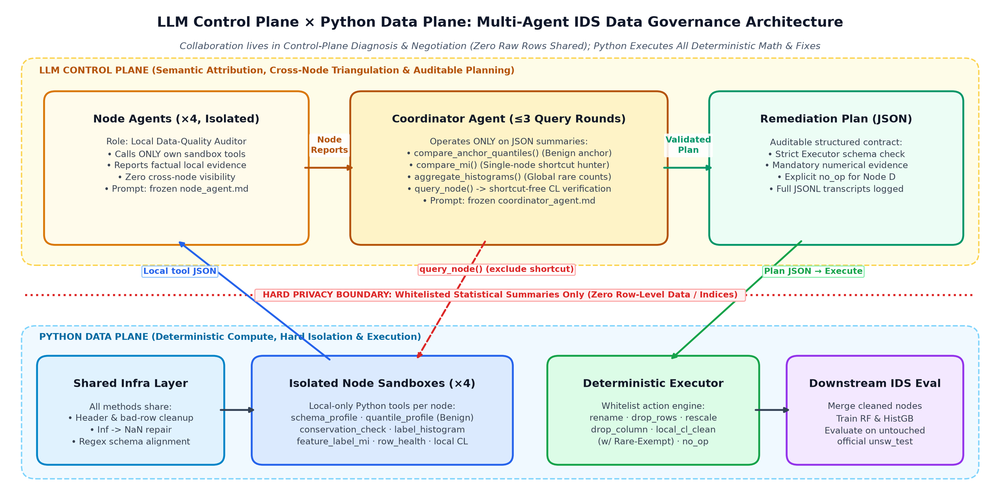

# LLM 控制面 × Python 数据面：面向多源异构入侵检测数据的多智能体协同体检与治理

> **《网络空间安全实训》课程期末大作业**  
> **核心主张**：多智能体跨节点协作的不可替代价值在**控制面**（异构诊断、故障归因、跨节点捷径猎杀与治理协商），不在样本级原型互投；**LLM 负责语义推理与跨节点协商，Python 负责一切确定性计算、硬隔离沙箱与白名单执行。**

---

## 一、项目解决什么问题？

在多节点/跨机构联合构建网络入侵检测（NIDS）数据集时，简单合并各节点数据会同时遭遇五类交织隐患，而传统自动化脚本往往“顾此失彼”：

1. **跨版本与残余 Schema 异构**：部分列存在正则无法覆盖的语义别名或损坏表头 / `Inf` 异常行。
2. **隐性量纲/单位漂移**：某些探针节点以字节/千字节或比特/秒混用（如 `1000×`、`1024×`、`1/8×`），若直接按全表分位数暴力校准，会把合法的攻击分布差异一起拉平。
3. **单节点局部捷径（Shortcut / Leakage）**：某采集器附带的元数据列在单节点内部与标签高度相关，单节点审计极易把它当成“优质强特征”，上线跨节点/测试集却彻底失效。
4. **局部标签噪声与长尾罕见攻击（Rare-4）的冲突**：标准 Confident Learning 在 Non-IID 长尾场景下会误杀大量罕见攻击样本（如 `UNSW-NB15` 中的 `Worms`、`Shellcode`、`Backdoor`、`Analysis`）。
5. **合法分布差异（困难负例）与真故障的混淆**：仅凭整表统计漂移的固定阈值规则（`Static-Pipeline`），会把“独占 Rare-4 的健康节点”或“突发 DDoS 流量（`0.06% → 77.4%`）”误判为故障节点并错误清洗，导致少数类召回雪崩。

---

## 二、核心架构与硬隔离设计



系统采用严格的**控制面与数据面分离**架构，并在代码层强制执行**三条硬隔离规则**（由 [`tests/test_isolation.py`](tests/test_isolation.py) 与 [`tests/test_executor.py`](tests/test_executor.py) 自动化验证）：

1. **原始行零出域**：每个 `Node Agent` 的工具仅绑定本地 DataFrame；跨节点传输仅允许白名单内的紧凑 JSON 统计摘要（Benign 锚点分位数、物理守恒残差率、互信息、类别直方图等），**严禁传输任何行级数据或样本索引**。
2. **算判分离、白名单执行**：LLM 只负责诊断推理并输出结构化 JSON 治理方案（`Remediation Plan`），所有缩放、删列、重命名与本地去噪动作均由确定性 Python `Executor` 按白名单执行并记账。
3. **零泄漏通用提示词**：仅使用 2 套冻结的通用提示词（[`prompts/node_agent.md`](prompts/node_agent.md) 与 [`prompts/coordinator_agent.md`](prompts/coordinator_agent.md)），不含任何数据集名、具体列名、因子或硬编码阈值（由 [`tests/test_prompt_leak.py`](tests/test_prompt_leak.py) 审计）。

---

## 三、核心实验结果（全部基于冻结提示词与盲测场景）

### 1. UNSW-NB15 主实验（10 个随机化盲测场景 `seed 100–109`，官方 `unsw_test` 175,341 行）

| 方法组 | RF Macro-F1 (Mean±SD) | RF Rare-4 Recall | HistGB Macro-F1 (Mean±SD) | HistGB Rare-4 Recall | Rare-4 训练保留率 |
|---|---:|---:|---:|---:|---:|
| `Raw-Merge` | `0.4857±0.0029` | `0.2186` | `0.4419±0.0077` | `0.2153` | `100.0%` |
| `IForest-Clean` | `0.4839±0.0049` | `0.2193` | `0.4374±0.0047` | `0.2141` | `99.4%` |
| `Global-CL` | `0.4799±0.0162` | `0.2003` | `0.4398±0.0109` | `0.2030` | **`74.0%`**（误杀 26%） |
| `Static-Pipeline`（同工具无 LLM） | `0.4158±0.0013` | **`0.0000`** | `0.4131±0.0041` | **`0.0156`** | `88.8%` |
| `Ours w/o Coordinator` | `0.5269±0.0065`\* | `0.2966`\* | `0.4726±0.0077`\* | `0.1985` | `94.4%` |
| `Ours w/o Anchor` | `0.5124±0.0111` | `0.2200` | `0.4663±0.0114` | `0.1670` | `100.0%` |
| **`Ours (Full)`** | **`0.5173±0.0033`** | **`0.2224`** | **`0.4700±0.0041`** | **`0.1719`** | **`100.0%`** |
| `Oracle-Clean`（理论正交上界） | `0.5185±0.0030` | `0.2256` | `0.4739±0.0071` | `0.1812` | `100.0%` |

- **统计显著性**：在配对单侧 Wilcoxon 符号秩检验 + Holm 校正下，`Ours (Full)` 在 RF 与 HistGB 上均 **10/10 全胜**全部 4 个非 LLM 基线（`p_raw = 0.000977`，`p_holm = 0.0068 < 0.01`，`r_rb = 1.0`），相对同工具无 LLM 的 `Static-Pipeline` 分别提升 **`+0.1016`**（RF）与 **`+0.0569`**（HistGB），并逼近 `Oracle-Clean` 上界（RF 达 99.8%，HistGB 达 99.2%）。
- **控制面全项满分**：`Ours (Full)` 在 10 个盲测场景实现单位漂移 P/R/因子恢复 `1.00 / 1.00 / 1.00`、作弊列精确识别 `1.00`、残余别名映射 `1.00`、噪声节点检出 `1.00`（0 误报，样本级 Noise F1 `0.7947`）、**Node D 困难负例误处置 `0/10`**（对比 `Static-Pipeline` 在 10/10 场景全部错改 Node D 量纲导致 Rare-4 召回崩溃）。
- **诚实消融洞察**：\*`Ours w/o Coordinator` 控制面全面崩盘（漂移与别名修复均为 `0.00`，噪声节点召回仅 `0.10`），其 RF 分数虚高源于未修复的 `1000×/1024×` 漂移意外将多数类样本推离测试分布、变相起到多数类降采样效果——这正是必须同时考察控制面指标与 `Oracle-Clean` 上界的实证依据。

### 2. CICIDS-2017/2018 跨数据集亮点验证（零改动冻结提示词）

- **突发 DDoS vs 真故障归因（9 分片）**：在 `cic2017_Friday-DDos` 时序切片（DDoS 占比 `0.06% → 77.4%`）叠加跨天 `Tuesday Benign` 的 9 分片压测中，`Static-Pipeline` 误报 **`71.4% (5/7)`**，而 **`Ours (Full)` 实现 `0.0% (0/7)` 零误报与 `100.0% (2/2)` 真故障检出**。
- **CICIDS-2018 跨版本体检**：自动检出第 `413` 行嵌套字符串表头损坏与 `349` 个 `Inf`，正则映射对齐 `78` 列（原始精确交集仅 `28` 列）。

---

## 四、目录结构

```text
course_project/
├── README.md                  # 本说明文档
├── setup_env.py               # 一键环境、依赖与数据集检查脚本
├── prompts/                   # 冻结的通用提示词与 SHA256 清单
│   ├── node_agent.md
│   ├── coordinator_agent.md
│   └── FROZEN_MANIFEST.json
├── src/                       # 核心源码
│   ├── infra.py               # 共享基础设施层（坏表头/Inf 清理、正则对齐）
│   ├── tools_node.py          # Node 侧隔离沙箱工具（Benign 锚点、物理守恒、MI、CL）
│   ├── tools_coord.py         # Coordinator 侧跨节点摘要对比工具
│   ├── llm_client.py          # OpenAI Chat Completions 兼容客户端（脱敏与无接触读 Key）
│   ├── agents.py              # Node Agent & Coordinator Agent 协商循环
│   ├── executor.py            # 白名单确定性执行器（含 Rare-4 豁免）
│   ├── scenario_gen.py        # 随机化多节点故障生成器（开发/评测种子隔离）
│   ├── baselines.py           # Raw-Merge / IForest / Global-CL / Static-Pipeline / Oracle
│   ├── evaluate.py            # 下游 RF / HistGB 评测与控制面指标计算
│   ├── stats.py               # Wilcoxon + Holm 校正 + 10k Bootstrap 95% CI
│   ├── run_experiments.py     # P4–P6 自动化实验调度入口
│   ├── cicids_demo.py         # CICIDS-2017/2018 跨数据集泛化验证脚本
│   └── make_figures.py        # 5 张 220 DPI 论文级图表生成脚本
├── tests/                     # 9 项自动化单元测试（隔离 / 执行器 / 防泄漏）
├── results/                   # 汇总表与统计 JSON（main_table.csv, control_plane.csv, stats.json 等）
├── figures/                   # 5 张高清可视化图表（fig1–fig5.png）
├── report/                    # 完整课程报告、高光实录、PPT 框架、Q&A 备忘与精简指南
├── runs/                      # 各场景 ground_truth、plan 与指标落盘
└── transcripts/               # 脱敏后的完整 LLM 工具调用与协商 JSONL 实录
```

---

## 五、快速开始与复现指南

> 所有命令请在**工作区根目录**（`course_project/` 的上一级目录）下执行，并确保 `data/` 目录下包含 `unsw_train.parquet`、`unsw_test.parquet`（及可选的 `cic2017_Friday-DDos.csv`、`cic2017_tuesday_withIP.csv`、`cic2018_head.csv`）。

### 1. 环境与数据检查

```powershell
python course_project/setup_env.py
```

### 2. 零 API 费用验证（单元测试 + 统计汇总 + 图表重绘）

```powershell
# 运行全部 9 项自动化单元测试（隔离沙箱 + 白名单执行器 + 提示词防泄漏）
python -m pytest -v course_project/tests/

# 基于已落盘 runs/ 重新汇总结果与统计检验（不消耗 LLM Token）
python -u -m course_project.src.run_experiments --stage p6_aggregate --seeds 100-109 --clean-seeds 200-202

# 重新生成 figures/ 下全部 5 张 220 DPI 图表
python -m course_project.src.make_figures

# 校验提示词 SHA256 是否与 FROZEN_MANIFEST.json 一致
Get-FileHash course_project/prompts/node_agent.md, course_project/prompts/coordinator_agent.md -Algorithm SHA256
```

### 3. 完整复现实验流水线（需配置 LLM API）

如需从头重跑实时的 LLM 多智能体协商，请先通过环境变量配置兼容 OpenAI Chat Completions 协议的接口（切勿将 Key 写入任何代码或日志文件）：

```powershell
$env:LLM_API_KEY="sk-your-key"
$env:LLM_BASE_URL="https://api.openai-next.com/v1"
$env:LLM_MODEL="deepseek-v4-1-flash-261017"
```

随后按阶段运行：

```powershell
# 1. 非 LLM 对照基线（seed 100-109 与干净对照 200-202）
python -u -m course_project.src.run_experiments --stage p4_baselines --seeds 100-109 --clean-seeds 200-202

# 2. 运行冻结提示词的多智能体协商规划（支持 --workers 并发）
python -u -m course_project.src.run_experiments --stage p5_llm --seeds 100-109 --clean-seeds 200-202 --workers 4

# 3. 确定性执行全部消融组并在官方 unsw_test 评测
python -u -m course_project.src.run_experiments --stage p5_eval --seeds 100-109 --clean-seeds 200-202

# 4. 3 次重复稳定性验证（seed 100-102）与统计汇总
python -u -m course_project.src.run_experiments --stage p6_stability --seeds 100-102
python -u -m course_project.src.run_experiments --stage p6_aggregate --seeds 100-109 --clean-seeds 200-202

# 5. CICIDS-2017/2018 跨数据集亮点验证
python -u -m course_project.src.cicids_demo
```

---

## 六、报告与答辩材料导航

- **完整课程技术报告**：[`report/report.md`](report/report.md)（含五路线对比表、Phase 4/5 负结果一页、三大诚实消融剖析与复现附录）
- **真实协商高光实录**：[`report/highlights_transcript.md`](report/highlights_transcript.md)（含 `seed 102` 猎杀局部捷径与 CICIDS `slice_8` 放行实录）
- **答辩 PPT 框架**：[`report/ppt_outline.md`](report/ppt_outline.md)（13 页标准版 & 5 分钟精简版指引）
- **常见追问 Q&A**：[`report/qa_memo.md`](report/qa_memo.md)（7 个高频尖锐问题标准应答）
- **精简与交稿检查指南**：[`report/guide.md`](report/guide.md)
