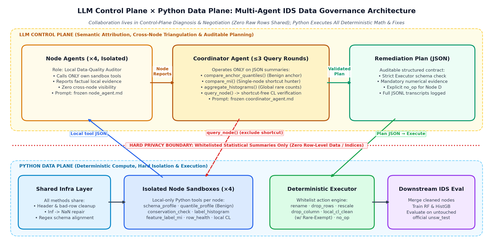
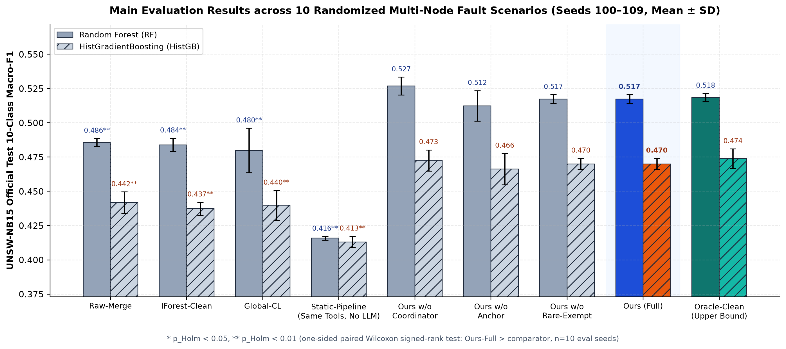
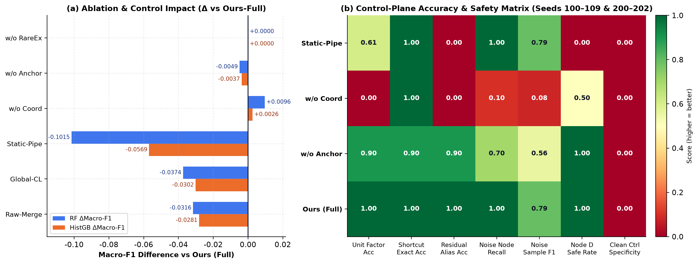
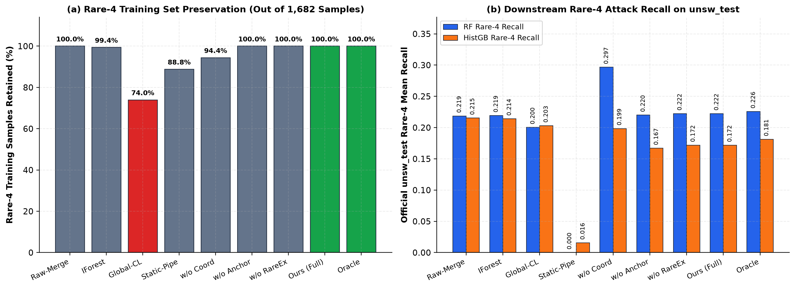
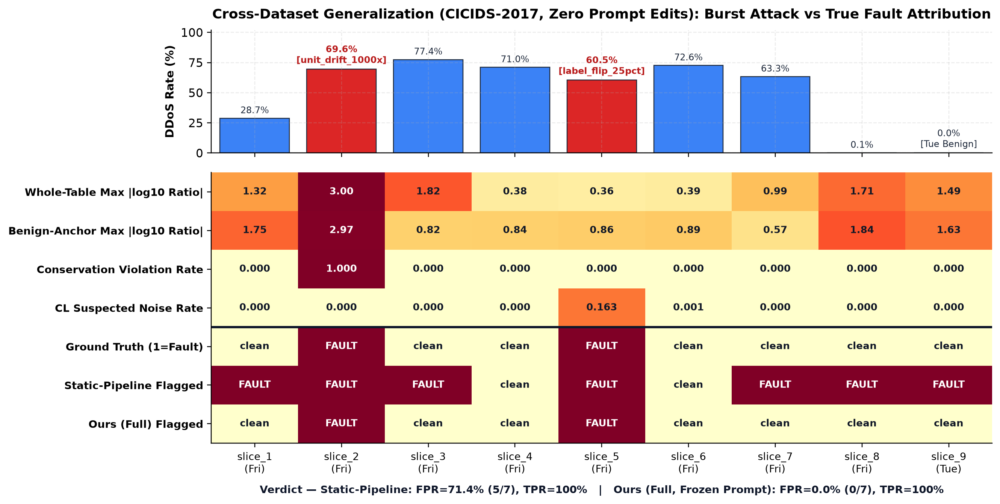

# LLM 控制面 × Python 数据面：面向多源异构入侵检测数据的多智能体协同体检与治理

> **课程实训完整技术报告**  
> **核心主张**：跨节点多智能体协作的真正价值在于**控制面（诊断、归因、跨节点三角印证与可审计治理规划）**，而非“样本级互投”；**LLM 负责语义推理与多轮协商，Python 负责一切确定性计算、隐私边界强制与治理执行**。

---

## 摘要

多分支安全运营中心（SOC）联合构建入侵检测（IDS）训练集时，常面临四类纠缠在一起的数据质量故障：**非标语义别名**、**采集器量纲/单位漂移**、**单节点采集元数据捷径（Shortcut Leakage）**以及**局部标签噪声**，同时叠加各节点天然的 **Non-IID 业务与稀有攻击分布差异**。传统方案陷入两难：若先合表再全局清洗（如 Isolation Forest、全局 Confident Learning），极易误杀集中在单一核心节点的长尾高危攻击（Rare-4）；若使用固定阈值的确定性规则管道（`Static-Pipeline`），整表漂移检测会把合法的 Non-IID 业务差异或突发攻击误判为量纲故障，导致灾难性误改。

本文提出并实现了 **“LLM 控制面 × Python 数据面”** 的双平面多智能体协同治理架构：
1. **硬隔离与共享基建**：将表头修复、`Inf` 清理与正则 Schema 对齐剥离为所有对比方法共享的基础设施层（非创新点）；每个节点沙箱仅暴露白名单统计摘要工具，代码级禁止任何行级明细或样本索引跨节点传输。
2. **控制面协同机制**：各节点 Agent 本地体检并汇报事实证据，中心 Coordinator Agent 结合 **Benign 锚点分位数比对**、**物理守恒残差校验**、**跨节点特征-标签互信息（MI）离群审计** 与 **全局类别直方图（仅计数）**，通过最多 3 轮 `query_node` 追问（先隔离作弊列再做去捷径的本地置信学习核验），输出带数值证据的结构化 JSON 治理方案，交由确定性 Python Executor 执行并全量落盘审计日志。
3. **防作弊实验规范**：采用随机化故障生成器（随机节点置换、随机漂移因子/受影响列/噪声率/作弊列名与残余语义别名），严格区分开发场景（`seed 0–2`）、盲测评测场景（`seed 100–109`）与零故障干净对照（`seed 200–202`）。两套通用提示词通过自动化防泄漏审计（`test_prompt_leak.py`）后在开发集上冻结（记录 SHA256），再一次性运行全部评测场景。

在 **10 个盲测随机化 UNSW-NB15 多节点场景 × 2 个下游分类器（RF / HistGB）** 上，本方案（`Ours (Full)`）取得：
- **下游主终点（官方 `unsw_test` 10 类 Macro-F1）**：RF 达 **`0.5173 ± 0.0033`**（逼近 `Oracle-Clean` 上界 `0.5185` 的 **99.8%**），HistGB 达 **`0.4700 ± 0.0041`**（达上界 `0.4739` 的 **99.2%**）。配对单侧 Wilcoxon + Holm 校正检验表明，在两个分类器上均以 **10/10 全胜**显著超越全部四个非 LLM 基线（`p_holm = 0.0068 < 0.01`, `r_rb = 1.0`），尤其相对同工具无 LLM 核心对照 `Static-Pipeline` 分别领先 **`+0.1016`**（RF）与 **`+0.0569`**（HistGB）。
- **控制面精度与安全边界**：在全部 10 个盲测场景上，单位漂移 P/R/因子恢复率、作弊列精确识别率、残余语义别名映射率、噪声节点检出率与脏行修复率均达 **`100.0%`（10/10）**，样本级噪声 F1 达 **`0.7947`**，困难负例 Node D **零误处置（0/10）**，Rare-4 训练集保留率 **`100.0%`**（对比 `Global-CL` 误杀 26.0% 仅剩 `74.0%`，`Static-Pipeline` 对 Node D 触发 100 次误改导致 RF Rare-4 召回归零）。
- **跨数据集零改动泛化**：不修改提示词一个字符，直接迁移至 **CICIDS-2017**（周五 DDoS 0.06%→77.4% 8 个时序分片 + 周二 Benign 第 9 分片），`Static-Pipeline` 误报 **`71.4% (5/7)`** 干净分片，而 `Ours (Full)` 实现 **`0.0% FPR (0/7)`** 与 **`100.0% TPR (2/2)`**。
- **诚实消融与局限披露**：本文完整汇报了 `Ours w/o Coordinator` 下游 RF 虚高超 Oracle 的统计悖论（控制面全面崩盘但未修的 1000× 漂移意外降采样多数类）、零故障干净对照 `200–202` 上相对噪声基准引发的保守度不足（但由 Rare-Exempt 兜底实现 100% 稀缺留存与 F1 无损），以及 3 次重复实验 `8/9` 全项精确一致（两两一致率 `77.8%`）的真实稳定性边界。

---

## 第 1 章 问题背景与痛点

在企业、校园网或多分支 SOC 联合建设入侵检测系统（IDS）训练数据集时，原始网络流特征分散于不同网段、不同版本或不同厂商的镜像探针。直接汇聚多源数据会遭遇两类截然不同的“分布差异”：

1. **必须保护的合法 Non-IID 差异**：核心业务区与边缘接入区的正常/攻击配比天然不同；极低频高危攻击（如 UNSW-NB15 中的 `Analysis`、`Backdoor`、`Shellcode`、`Worms`，合计仅占训练集 2.04%，其中 `Worms` 仅 44 条）往往仅出现在单一高价值节点；或某一时段发生真实 DDoS 突发导致流量统计量剧烈跃升。
2. **必须修复的多重隐蔽数据故障**：
   - **采集口径与语义别名漂移**：正则无法穷举的非标业务列名（如 `handshake_roundtrip_val` 对应 `tcprtt`）导致合表后大面积缺失；
   - **量纲/单位错配**：某探针误以比特而非字节、或以千字节/KiB 导出流量体积与负载（倍率如 `1000×`、`1024×`、`1/8×`），叠加 1–2% 的 `-999` 负哨兵与 `Inf/NaN` 脏行；
   - **局部采集元数据捷径（Shortcut Leakage）**：某实验/测试网探针携带与标签高度耦合的采集标签列（其余节点与线上测试集为无关随机值），导致模型学到“伪捷径”并在测试集泛化崩盘；
   - **局部标签噪声**：个别节点因粗粒度规则打标存在 22%–35% 的标签翻转，且在存在作弊列时会被本地交叉验证完全掩盖。

**现有两类主流路线的根本困境**：
- **先合表再全局清洗**（Isolation Forest、全局 Cleanlab）：违背数据不出域边界，且在 Non-IID 下无法区分“孤立标签噪声”与“单节点稀缺高危攻击”，造成严重稀缺类误杀。
- **固定阈值规则管道**（TFDV / Great Expectations / 静态阈值脚本）：只能机械计算分位数偏移，**会算但不会“判”**——面对 19× 的整表耗时偏移（Node D 合法类别差异）与 1000× 的单位故障，固定规则缺乏跨工具语义三角印证能力，极易误伤合法 Non-IID 节点。

---

## 第 2 章 理论基础、路线对比与“控制面协作”设计原则

### 2.1 五类相关技术路线对比矩阵

| 技术路线 / 代表工作 | 物理守恒校验 | Non-IID 保稀 | 跨节点捷径隔离 | 跨节点协作机制 | 原始数据隐私边界 | 核心局限 |
|---|:---:|:---:|:---:|:---:|:---:|---|
| **静态数据校验框架**<br>（Great Expectations / TFDV） | 弱（需人工硬编码） | 无 | 无 | 无（单表告警） | 本地单表 | 只报警不自动归因修复；整表漂移在 Non-IID/攻击突发下高误报 |
| **样本级标签去噪**<br>（Cleanlab / Confident Learning） | 无 | 差（全局误杀稀缺） | 无（会被捷径掩盖） | 无（需集中合表） | 需集中原始样本 | 集中跑会误杀单节点 Rare-4；有捷径列时本地 CV 失灵 |
| **元数据捷径审计**<br>（Domain/Shortcut Auditing） | 无 | 无 | 强（跨节点 MI） | 特征级对比 | 需合表或摘要 | 单一能力，不处理量纲漂移、语义别名与标签噪声协同 |
| **单表 LLM 清洗**<br>（LLMClean / Table-Critic / TabClean） | 弱 | 无 | 无 | 无（单表上下文） | 常直接喂入行样本 | 让 LLM 直接看/改明细行，既泄露隐私又易出现数值幻觉 |
| **联邦/分布式数据筛选**<br>（FedES 等） | 无 | 中 | 无 | 梯度/原型级 | 不传明文行 | 样本级互投在极端 Non-IID 下易误伤单节点稀有类（见 2.3 节负结果） |
| **本文方案（LLM 控制面 × Python 数据面）** | **强（主/辅守恒）** | **强（零误处置 + 稀缺豁免）** | **强（跨节点 MI 离群）** | **控制面摘要多轮协商** | **硬隔离（仅白名单摘要）** | 受限于 LLM 推理成本与极端零故障下相对基准敏感度（见第 7 章） |

### 2.2 核心论证三句话

1. **规则工具会“算”但不会“判”**：同样是数十倍乃至上千倍的分位数差异，既可能是单位换算错误，也可能是合法的类别构成差异（Node D）或真实 DDoS 突发（CICIDS-2017）——必须结合 Benign 锚点、物理守恒残差与类别分布做语义三角印证。
2. **LLM 会“判”但不可信于“算”**：绝不让 LLM 直接计算分位数或修改原始数据行；一切统计计算、置信学习与数据变换均交由确定性 Python 工具执行，LLM 仅消费脱敏 JSON 摘要、发起追问并输出带数值证据的治理方案。
3. **有些故障单节点根本看不见**：作弊列在单节点内部表现为“完美高信息增益特征”（本地 `mi_norm ≈ 1.0`），还会掩盖同一节点上的标签噪声；只有跨节点对比特征-标签互信息，才能识别其为单节点特异捷径并在追问轮中将其排除以暴露底层标签噪声——这才是多智能体跨节点协作不可替代的真实价值。

### 2.3 确立设计原则的前期负结果（为什么不在样本级做跨节点互投）

在确立本方案之前，项目前期预实验（Phase 4/5 红队加测，详见项目留档 `phase4_pilot_summary.md`）曾探索“跨节点 K-means 类原型互投（`Ours_MAS_v3`）”与“零通信本地稀缺豁免去噪（`B6_LocalOnly_RareExempt_CL`）”的样本级协作路线。在 UNSW-NB15 5 节点 Non-IID → 官方 `unsw_test` 5 种子实测中：
- 跨节点原型互投仅取得 RF Macro-F1 **`0.4635`**，反而**显著逊于零通信本地去噪 `B6`（`0.4751`，差异 `-1.16` 个百分点，`p = 0.0044`）**，且在 HistGB 与 MLP 上均未超越本地基线。

这一决定性负结果证伪了“样本级去噪需要跨节点互投”的伪多智能体叙事，直接确立了本文的核心架构铁律：**去噪执行归本地，协作价值在控制面**——Coordinator 仅汇总全局类别计数直方图（零样本传输）以定义全局稀缺类，并负责跨节点量纲对齐、捷径猎杀、多轮追问取证与节点级处置仲裁。

---

## 第 3 章 系统架构与硬隔离工程设计

### 3.1 总体架构



系统严格划分为 **共享基础设施层**、**Python 数据面（隔离沙箱 + 确定性执行器）** 与 **LLM 控制面（Node Agents + Coordinator Agent）** 三个层次：

1. **共享基础设施层（`src/infra.py`，所有方法共用，不计入创新）**：执行表头空白规范化、重复表头行自动剥离、`±Inf → NaN` 转换以及确定性正则 Schema 对齐。该层保证不会将“20 行正则能解决的常规列名规范化”包装成 LLM 创新；LLM 仅处理正则未命中的残余语义别名列。
2. **节点沙箱与本地工具集（`src/tools_node.py`）**：每个节点被封装在独立的 `NodeSandbox` 对象中，私有持有本地 DataFrame `_df`，仅暴露 7 个确定性只读诊断工具：
   - `schema_profile()`：列清单、dtype、缺失率、正则未命中残余列及其 Benign 锚点分布轮廓；
   - `quantile_profile(label_filter="Normal")`：Benign 锚点分位数（含正值中位数 `p50_pos`，规避零膨胀列除零问题）；
   - `conservation_check()`：物理守恒校验——两条主守恒式（容差 5%）：`sbytes ≈ spkts × smean`、`dbytes ≈ dpkts × dmean`，以及两条量级辅助式（容差 50%）：`sload ≈ sbytes × 8 / dur`、`dload ≈ dbytes × 8 / dur`；
   - `label_histogram()`：本地类别计数与攻击占比；
   - `feature_label_mi()`：各数值列与标签的归一化互信息 `MI(X; Y) / H(Y)`；
   - `row_health()`：NaN 行、物理非负列出现负值的行数及基础设施层修复统计；
   - `confident_learning(exempt_classes, exclude_cols)`：本地 3 折分层交叉验证置信学习，采用噪声自适应自置信阈值 $t_j = \mathbb{E}[\hat{p}(\tilde{y}=j\mid x)\mid \tilde{y}=j]$ 计算 `suspected_noise_rate`、`high_conf_conflict_rate`、`mean_self_confidence` 与 `cv_macro_f1`；**疑似噪声行索引严格留存节点本地，绝不跨边界返回**。
3. **协调器摘要工具（`src/tools_coord.py`）**：仅操作节点 JSON 摘要，绝不持有任何 DataFrame 引用：
   - `compare_anchor_quantiles()`：计算跨节点稳健中位参考倍率与 $\log_{10}$ 漂移量，并生成“残余未映射列 vs 缺失规范列”的参考分布对照表；
   - `compare_mi()`：计算每个特征跨节点归一化 MI 的极差与稳健 z-score（MAD 下界 `0.02`），精准暴露单节点作弊列；
   - `aggregate_histograms()`：汇总全局类别计数（零样本），识别全局稀缺类及其集中宿节点；
   - `query_node(node, tool, args)`：向指定节点发起最多 3 轮白名单追问（典型闭环：先由 `compare_mi` 识别作弊列 → 追问各节点以 `exclude_cols=[作弊列], exempt_classes=[全局稀缺类]` 重跑 `confident_learning`）。
4. **确定性执行器（`src/executor.py`）**：严格校验 Coordinator 输出的 Remediation Plan JSON（每条动作必须附非空 `evidence` 数值引用），按固定确定性顺序执行白名单动作：`rename_columns → drop_rows → rescale → drop_column → local_cl_clean → quarantine_node → no_op`。

### 3.2 三条代码级硬隔离铁律与自动化审计

- **铁律 1（零行级数据出域）**：所有节点工具返回值必须通过 `assert_summary_safe()` 递归白名单校验，拦截任何 `DataFrame`、`Series`、`ndarray`、含 `row_indices/raw_rows` 键名或超长列表（`>80` 项）。已通过 `tests/test_isolation.py`（4/4 PASSED）。
- **铁律 2（LLM 零数据写权限）**：LLM 只产出 JSON 方案，由 `validate_plan()` + `execute_remediation_plan()` 校验执行，已通过 `tests/test_executor.py`（3/3 PASSED）。
- **铁律 3（全程审计与防泄漏冻结）**：所有 LLM 请求、工具调用与响应脱敏落盘为 `transcripts/<scenario>/*.jsonl`；API Key 仅在运行时无接触只读加载并经正则脱敏保护，绝不落盘或打印。两套通用提示词（`prompts/node_agent.md` 与 `prompts/coordinator_agent.md`）仅包含通用角色、工具定义与统计学原则，**不含任何具体列名、漂移因子、节点编号、数值阈值、数据集名或攻击类名**，通过 `tests/test_prompt_leak.py`（2/2 PASSED）并在 P3 后冻结：
  - `node_agent.md` SHA256：`67f1ba2cd5bb521ad01554ac86d1f1e79e962333d053003818110111a10f6602`
  - `coordinator_agent.md` SHA256：`b479ebeb457d7b562f28f340c1fff8cee8781d8bbea083f87a4e817feb8ece7d`

---

## 第 4 章 随机化实验场景与评测协议

### 4.1 Non-IID 节点切分与困难负例构造

基于官方 `unsw_train.parquet`（82,332×36），固定基础切分为 4 个业务角色，所有模型统一在未触碰的官方 `unsw_test.parquet`（175,341×36）上评测：
- **Role A（健康基准，25,777 行）**：非 Rare-4 类分层抽样；
- **Role B（异构与脏行故障目标，23,936 行）**：非 Rare-4 类分层抽样；
- **Role C（噪声与捷径故障目标，23,935 行）**：非 Rare-4 类分层抽样；
- **Role D（长尾独占困难负例，8,684 行）**：独占**全部 Rare-4**（`Analysis` 677、`Backdoor` 583、`Shellcode` 378、`Worms` 44，共 1,682 条）+ 3,500 条 `Normal`（保障 Benign 锚点存在）+ 偏斜配比的其他攻击类（不含 `Generic`），**零故障注入**。

**困难负例实证检验（P1 阶段）**：在干净场景下，Role D 的**整表** `dur` 中位数为 `0.19s`，相对 Role A/B/C（`0.01s`）高达 **19× 偏移**（`sload` 亦有 2.8× 偏移）；但在 **Benign 锚点（仅 Normal 行）** 下，Role D 的 `dur=0.21s` vs `0.22s`、`dbytes=354` vs `354`、`sbytes=962` vs `978`，与其余节点几乎完全重合（`~1.0×`）。这构造了高度逼真的 Non-IID 困难负例陷阱。

### 4.2 随机化故障生成器与严格种子隔离

为彻底杜绝“提示词背答案”质疑，`src/scenario_gen.py(seed)` 在每个场景中全随机化注入：
1. **节点编号随机置换**：`A/B/C/D → {node_1..node_4}` 每次随机重排；
2. **Role B 故障**：随机抽取 2–3 列替换为正则不可命中的语义别名（从 12 列语义词库抽取）+ 随机单位漂移因子 $\in \{1000, 1/8, 1024\}$ 作用于随机 2–4 个字节/负载列 + 1.2%–2.0% 脏行（负哨兵 `-999/-1`、`Inf/NaN` 及 1 行重复表头）；
3. **Role C 故障**：标签噪声率 $\sim \text{Uniform}(0.22, 0.35)$（P1 校准使单节点故障对全局 RF/HistGB Macro-F1 均稳定造成 `≥ 0.02` 退化，实测均值退化 RF `+0.0312`、HistGB `+0.0354`）+ 单节点作弊列（列名从 10 个采集元数据名池随机抽取；在所有节点与测试集均存在，仅 Role C 上等于观测标签编码加微小噪声，其余节点及 `unsw_test` 上为同分布独立随机值）；
4. **种子隔离**：`seed 0–2` 为开发集（仅用于 P3 提示词调优与验证，验收 3/3 满分后立即冻结提示词）；`seed 100–109` 为 10 个盲测评测场景（冻结后一次性运行）；`seed 200–202` 为 3 个零故障干净对照场景（测误处置率）。

**P1 物理守恒实测校准记录**：在干净 `unsw_train` 上实测，`sbytes ≈ spkts × smean` 中位相对误差为 `0.0000`（p90=`0.0071`），`dbytes ≈ dpkts × dmean` 中位相对误差为 `0.0037`（p90=`0.0078`），均远低于 5% 验收门；而 `sload ≈ sbytes × 8 / dur` 因官方流时长精度截断，中位相对误差为 `0.0989`（>50% 比例仅 `2.88%`），故在 `conservation_check()` 中明确将前两者设为 5% 主守恒式、后两者设为 50% 量级辅助参考式。

### 4.3 对比组、消融组与预注册统计方案

全部 9 组方法共享同一基础设施层与下游模型配置（`RF`: 150 树 `class_weight="balanced_subsample"`；`HistGB`: 150 轮 `max_depth=10, min_samples_leaf=10`）：
- **非 LLM 对照组**：`Raw-Merge`（下界）、`IForest-Clean`（经典 5% 行级异常剔除）、`Global-CL`（全局无豁免置信学习）、`Static-Pipeline`（**核心对照**：调用完全相同的 Python 工具，固定顺序 + 固定阈值，整表漂移 `|log10|≥0.70`、固定 MI 阈值、无稀缺豁免 CL、纯分位数距离别名匹配）、`Oracle-Clean`（隐藏真值完美治理上界）。
- **消融与完整组**：`Ours w/o Coordinator`（仅本地节点独立决策，无跨节点对比）、`Ours w/o Anchor`（整表分位数替代 Benign 锚点）、`Ours w/o Rare-Exempt`（复用 Full 方案但执行器关闭稀缺豁免）、`Ours (Full)`（完整方案）。
- **统计检验（预注册）**：RF 与 HistGB 分开检验（不混池），`Ours (Full)` 相对各对照执行配对单侧 Wilcoxon 符号秩检验 + Holm-Bonferroni 多重比较校正 + 10,000 次 Bootstrap 95% CI + 配对秩双列相关效应量 $r_{\text{rb}}$。

---

## 第 5 章 主实验结果、消融剖析与诚实讨论

### 5.1 下游主终点与 Rare-4 保护结果（10 个盲测场景 `seed 100–109`）



| 方法组 | RF Macro-F1 (均值±SD) | RF Rare-4 Recall | RF 二分类 F1 | HistGB Macro-F1 (均值±SD) | HistGB Rare-4 Recall | HistGB 二分类 F1 | Rare-4 训练保留率 |
|---|---:|---:|---:|---:|---:|---:|---:|
| `Raw-Merge` | `0.4857 ± 0.0029` | `0.2186` | `0.9153` | `0.4419 ± 0.0077` | `0.2153` | `0.9151` | `100.0%` |
| `IForest-Clean` | `0.4839 ± 0.0049` | `0.2193` | `0.9141` | `0.4374 ± 0.0047` | `0.2141` | `0.9134` | `99.4%` |
| `Global-CL` | `0.4799 ± 0.0162` | `0.2003` | `0.9192` | `0.4398 ± 0.0109` | `0.2030` | `0.9164` | **`74.0%`** |
| `Static-Pipeline` | `0.4158 ± 0.0013` | **`0.0000`** | `0.9244` | `0.4131 ± 0.0041` | **`0.0156`** | `0.9151` | `88.8%` |
| `Ours w/o Coordinator`* | `0.5269 ± 0.0065`* | `0.2966`* | `0.9254` | `0.4726 ± 0.0077`* | `0.1985` | `0.9181` | `94.4%` |
| `Ours w/o Anchor` | `0.5124 ± 0.0111` | `0.2200` | `0.9257` | `0.4663 ± 0.0114` | `0.1670` | `0.9190` | `100.0%` |
| `Ours w/o Rare-Exempt` | `0.5173 ± 0.0033` | `0.2224` | `0.9273` | `0.4700 ± 0.0041` | `0.1719` | `0.9192` | `100.0%` |
| **`Ours (Full)`** | **`0.5173 ± 0.0033`** | **`0.2224`** | **`0.9273`** | **`0.4700 ± 0.0041`** | **`0.1719`** | **`0.9192`** | **`100.0%`** |
| `Oracle-Clean`（上界） | `0.5185 ± 0.0030` | `0.2256` | `0.9265` | `0.4739 ± 0.0071` | `0.1812` | `0.9198` | `100.0%` |

*\*注：`Ours w/o Coordinator` 的下游 RF 分数虚高反超 `Oracle-Clean` 是一个极具启发性的统计悖论，详见 5.3.1 节控制面与机理深度剖析。*

### 5.2 配对统计检验（Wilcoxon + Holm + Bootstrap 95% CI）

| 对比组 (`Ours-Full` vs Comparator) | 分类器 | 均值差 ΔMacro-F1 | Bootstrap 95% CI | 胜/平/负 | $p_{\text{raw}}$ | $p_{\text{Holm}}$ | 效应量 $r_{\text{rb}}$ | 显著 ($<0.05$) |
|---|---|---:|---|---:|---:|---:|---:|:---:|
| vs `Raw-Merge` | RF | **`+0.0317`** | `[+0.0292, +0.0338]` | 10/0/0 | 0.000977 | **0.0068** | `1.000` | **是** |
| vs `IForest-Clean` | RF | **`+0.0334`** | `[+0.0301, +0.0364]` | 10/0/0 | 0.000977 | **0.0068** | `1.000` | **是** |
| vs `Global-CL` | RF | **`+0.0374`** | `[+0.0270, +0.0477]` | 10/0/0 | 0.000977 | **0.0068** | `1.000` | **是** |
| vs **`Static-Pipeline`** | RF | **`+0.1016`** | `[+0.0999, +0.1033]` | 10/0/0 | 0.000977 | **0.0068** | `1.000` | **是** |
| vs `Ours w/o Anchor` | RF | `+0.0049` | `[+0.0000, +0.0122]` | 3/7/0 | 0.125000 | 0.3750 | `1.000` | 否 |
| vs `Raw-Merge` | HistGB | **`+0.0281`** | `[+0.0221, +0.0338]` | 10/0/0 | 0.000977 | **0.0068** | `1.000` | **是** |
| vs `IForest-Clean` | HistGB | **`+0.0326`** | `[+0.0295, +0.0357]` | 10/0/0 | 0.000977 | **0.0068** | `1.000` | **是** |
| vs `Global-CL` | HistGB | **`+0.0302`** | `[+0.0239, +0.0367]` | 10/0/0 | 0.000977 | **0.0068** | `1.000` | **是** |
| vs **`Static-Pipeline`** | HistGB | **`+0.0569`** | `[+0.0536, +0.0606]` | 10/0/0 | 0.000977 | **0.0068** | `1.000` | **是** |
| vs `Ours w/o Anchor` | HistGB | `+0.0037` | `[-0.0002, +0.0091]` | 2/7/1 | 0.250000 | 0.7500 | `0.667` | 否 |

**核心结论**：`Ours (Full)` 在 RF 与 HistGB 上均以 **10/10 全胜**显著击败全部四个非 LLM 基线（含同工具无 LLM 对照 `Static-Pipeline`，`p_holm = 0.0068 < 0.01`），且性能紧贴隐藏真值上界 `Oracle-Clean`（RF 差距仅 `-0.0012`，HistGB 仅 `-0.0039`）。

### 5.3 控制面指标、稀缺类保护与三大诚实学术洞察





| 方法组 | 单位漂移 P / R / 因子 | 作弊列精确率 | 残余别名准确率 | 噪声节点召回 / 误报数 | 样本级 Noise F1 | 脏行修复 | Node D 误处置(总计/10) | 平均 Tokens / 追问轮 / 耗时 |
|---|---:|---:|---:|---:|---:|---:|---:|---:|
| `Static-Pipeline` | `0.265 / 1.00 / 0.608` | `1.00` | `0.00` | `1.00 / 10` | `0.7947` | `1.00` | **`100`** | `0 / 0 / <1s` |
| `Ours w/o Coordinator` | `0.000 / 0.00 / 0.000` | `1.00` | `0.00` | `0.10 / 7` | `0.0808` | `0.00` | **`5`** | `41.1k / 0.0 / 173s` |
| `Ours w/o Anchor` | `0.900 / 0.90 / 0.900` | `0.90` | `0.90` | `0.70 / 0` | `0.5554` | `0.90` | `0` | `68.6k / 0.7 / 127s` |
| **`Ours (Full)`** | **`1.000 / 1.00 / 1.000`** | **`1.00`** | **`1.00`** | **`1.00 / 0`** | **`0.7947`** | **`1.00`** | **`0`** | `63.4k / 1.2 / 136s` |

#### 洞察 1：`Static-Pipeline` 为何在同工具条件下惨败？
`Static-Pipeline` 拥有完全相同的 Python 工具，且确实识别了作弊列（10/10）与噪声节点（10/10）。但因为缺乏 LLM 的跨证据语义推理，它遭遇三重致命失效：
1. **整表漂移误杀 Node D（100 次误处置）**：将 Node D 合法的 19× `dur` 分布差异与多列 Non-IID 偏移误判为单位漂移并强行缩放，彻底扭曲了 Node D 的真实物理量纲，导致 Rare-4 在官方测试集上的 RF 召回率直接**归零（`0.0000`）**、HistGB 跌至 **`0.0156`**；
2. **残余语义别名全部失灵（`0.00`）**：无语义理解仅靠整表分位数距离，无法完成异名同义列的可靠对齐；
3. **无稀缺豁免误删 Rare-4**：在 Node D 上同时误触发 `local_cl_clean`，额外删掉 11.2% 的 Rare-4 样本。

#### 洞察 2（诚实悖论）：为什么 `Ours w/o Coordinator` 控制面崩盘却在 RF 下游分数反超 `Oracle-Clean`？
若只看下游 RF Macro-F1，`Ours w/o Coordinator` 达到 `0.5269`，竟然高于真值完美清洗上界 `Oracle-Clean`（`0.5185`）！深入核查 `runs/seed_100/metrics_Ours-wo-Coordinator.json` 揭开了真相：
- **控制面事实**：无 Coordinator 时，各节点完全无法修复单位漂移（`0.00`）、无法映射残余别名（`0.00`）、无法修复脏行（`0.00`），且因作弊列掩盖导致噪声节点检出率仅 `0.10`（同时对健康节点误报 `7` 次，误伤 Node D `5` 次，Rare-4 留存跌至 `94.4%`）。它仅因 `schema_profile` 将作弊列标为非规范列而“碰巧”删掉了作弊列。
- **统计机理**：留着未修复的 Role B（约 23,936 条非 Rare-4 样本，占训练集 29%）保持 `1000×/1024×` 异常量纲，会将这批多数类攻击推离 `unsw_test` 的真实特征区间，**意外起到了“多数类降采样”的副作用**，使 RF 的决策边界向极少类 `Worms` 倾斜（RF Rare-4 召回从 `Oracle` 的 `0.2256` 虚高至 `0.2966`，`Worms` F1 跳升至 `0.533`）。
- **方法论启示**：这一实证反例强有力地证明了我们在方案设计（Q8 & Q9）中坚持增设**控制面精确率/召回率**与 **`Oracle-Clean` 上界**的必要性——如果仅用单一不平衡 Macro-F1 指标评价数据治理系统，连“留着 1000× 坏数据不修”都可能拿到虚高分数！

#### 洞察 3：Benign 锚点、Rare-Exempt 与零故障干净对照（`seed 200–202`）的诚实边界
- **Benign 锚点的作用（`Ours w/o Anchor`）**：在 10 个盲测场景中，物理守恒校验在 7/10 场景下帮助 LLM 救回了 Node D（避免了 `Static-Pipeline` 式的崩盘），但整表分位数噪音仍导致 Coordinator 在 3/10 场景下判断紊乱或跳过 CL 追问（`avg_coord_rounds` 由 `1.2` 降至 `0.7`），使噪声节点检出率跌至 `0.70`、样本级 Noise F1 跌至 `0.5554`（对比 Full `0.7947`）。
- **Rare-Exempt 的纵深防御价值与干净对照局限**：在 10 个故障场景上，因为 `Ours (Full)` 已实现 Node D 零误处置，关闭 `Rare-Exempt` 的结果与 `Full` 一致；但在 **3 个零故障干净对照（`seed 200–202`）** 上，`Ours (Full)` 虽然对全部 Schema、量纲、脏行和作弊列做到**零误报**，却因缺乏真正的高噪节点作为参照，对类别数更多（10 类 vs 6 类）、样本更小（8.7k vs 24k）的 Node D 产生了相对敏感（`suspected_noise_rate = 0.110` vs 同伴 `0.043`），触发了 `local_cl_clean`。**关键的是，由于携带了全局 `Rare-Exempt` 豁免，Node D 的 1,682 条 Rare-4 实现 100.0% 零损失保留，下游 RF Macro-F1 保持 `0.4950–0.5043`（与 Oracle `0.4977–0.4995` 几乎无损，而 `Static-Pipeline` 在干净对照上依然跌至 `0.4024`）**。同时我们也诚实将 `clean_control_fpr = 1.0` 记录为当前版本局限，并在第 7 章提出按类别熵/样本量归一化的 CL 相对基线改进方向。

### 5.4 稳定性与成本评估

在 `seed 100–102` 上以 `temperature = 0` 各独立重复运行 3 次（共 9 次完整多智能体协商）：
- **故障级精确一致**：**8/9 次（88.9%）**实现全部 5 项治理动作 100% 精确无误且 Node D 零误处置（`seed 100` 3/3 100% 一致，`seed 101` 3/3 100% 一致）；
- **单次偶发偏差分析**：`seed 102` 第 3 次重复中，Coordinator 精确完成了 `1/8` 比特/字节漂移还原（`factor = 8.0`）、3 个语义别名、作弊列删减、脏行清理与 Node D 零误报，但因 `coord_query_rounds = 0` 跳过了一轮 CL 追问而漏掉噪声节点清洗，使三场景均值两两精确一致率为 **`77.8%`**；
- **成本统计**：`Ours (Full)` 平均每场景消耗 **`63,362` tokens**（约 10–11 次 LLM 调用，1.2 轮追问，墙钟耗时 136s），属于典型离线训练前数据体检场景完全可接受的一次性开销。

---

## 第 6 章 跨数据集零改动泛化验证（CICIDS-2017 / CICIDS-2018）



为检验通用提示词是否真正脱离 UNSW-NB15 特定先验，我们在**冻结提示词零修改**（SHA256 完全一致）的前提下，直接迁移至真实时序数据集 CICIDS-2017 与跨版本 CICIDS-2018：

1. **突发 DDoS 攻击 vs 真故障归因（CICIDS-2017）**：将 `cic2017_Friday-DDos.csv`（225,745 行）按真实时间顺序切为 8 个分片（`slice_1..8`，DDoS 占比自然从 `0.06%` 飙升至 `77.43%`），并拼入跨天 `cic2017_tuesday_withIP.csv` 纯正常流量作为 `slice_9`（跨天 Benign 压测）。在其中 2 个分片注入真实故障：`slice_2` 施加 `1000×` 量纲漂移、`slice_5` 施加 `25%` 标签翻转。
   - **`Static-Pipeline`（整表漂移规则）**：受 DDoS 突发和跨天流量特征波动影响，误报 **`5/7` 个干净分片（`FPR = 71.4%`）**（含 `slice_1, 3, 7, 8, 9`）；
   - **`Ours (Full)`（零改动冻结提示词）**：精准检出 `slice_2`（精确还原 `factor = 0.001`）与 `slice_5`（触发 `local_cl_clean`），对全部 7 个干净分片（含 `77.4%` DDoS 高峰 `slice_3`、极不平衡仅 17 条攻击导致 `cv_macro_f1 = 0.4999` 的 `slice_8`、以及跨天周二 `slice_9`）均输出 `no_op`，取得 **`FPR = 0.0% (0/7)`、`TPR = 100.0% (2/2)`**！
2. **跨版本基础设施体检（CICIDS-2018 vs CICIDS-2017）**：共享基础设施层 `infra.py` 自动检出 `cic2018_head.csv`（8,397 行）中真实存在的 **1 行重复字符串表头（idx=413）** 与 **349 个 `Inf` 单元格**，并通过正则规范化将 CIC17↔CIC18 可对齐特征从原始精确同名交集 **28 列**提升至 **78 列**。

---

## 第 7 章 局限性声明与未来工作

1. **模拟边界诚实声明**：主实验的多节点故障采用受控合成注入（UNSW-NB15 静态表切分 + 随机化故障生成器），无法完全复现真实生产网络中的非对称路由丢包、TCP 重传抖动或渐进概念漂移；CICIDS-2017 时序分片与 CICIDS-2018 真实脏数据体检作为跨数据集现实补充。
2. **零故障干净对照的 CL 相对基线问题**：在 `seed 200–202` 零故障场景上，Coordinator 因缺少真实高噪节点对比，对 10 类小样本 Node D 的自然较高分类模糊度（`0.11` vs `0.04`）过于敏感。未来可在 `tools_node.py` 中增加**类别数/样本量校正后的预期噪声基线**或硬性强制要求 `query_node` 至少执行 1 轮（同样可消除 `seed 102 rep 2` 的偶发跳轮，将稳定性从 8/9 推向 9/9）。
3. **推理成本与多数投票**：离线数据体检虽可接受 136s / 63k tokens，但在大规模超百节点场景下可引入分层汇总与 3 次轻量化自一致性投票（Self-Consistency）进一步提升决策确定性。

---

## 附录：可复现性清单与自动化验证记录

- **完整代码与数据路径**：全部位于 `course_project/` 下（`src/`、`prompts/`、`tests/`、`runs/`、`transcripts/`、`results/`、`figures/`、`report/`）；根目录原始 `data/`、`legacy/`、`v2_research/` 与 Key 文件零改动。
- **冻结提示词清单**：`course_project/prompts/FROZEN_MANIFEST.json`。
- **自动化单元测试（`python -m pytest -v course_project/tests/`）**：**9/9 PASSED**（`test_isolation.py` 4/4、`test_executor.py` 3/3、`test_prompt_leak.py` 2/2）。
- **核心复现命令**：
  ```bash
  python -m pytest -v course_project/tests/
  python -u -m course_project.src.run_experiments --stage p4_baselines --seeds 100-109 --clean-seeds 200-202
  python -u -m course_project.src.run_experiments --stage p5_llm --seeds 100-109 --clean-seeds 200-202 --workers 4
  python -u -m course_project.src.run_experiments --stage p5_eval --seeds 100-109 --clean-seeds 200-202
  python -u -m course_project.src.run_experiments --stage p6_stability --seeds 100-102 --workers 3
  python -u -m course_project.src.run_experiments --stage p6_aggregate --seeds 100-109 --clean-seeds 200-202
  python -u -m course_project.src.cicids_demo
  python -m course_project.src.make_figures
  ```
